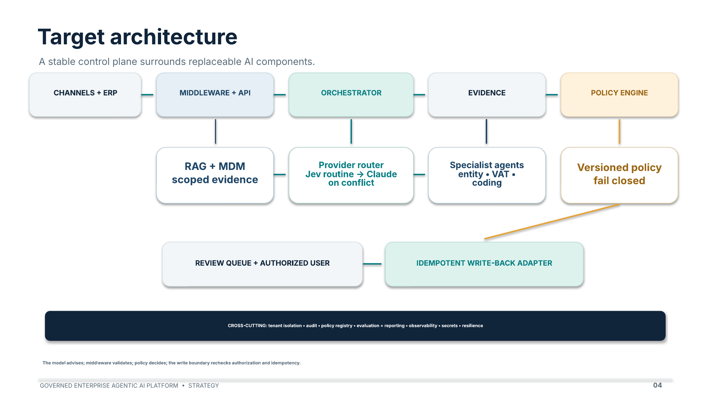

# Architecture: governed enterprise agentic AI platform

AP automation is the first proving ground for a reusable, governed platform. The core rule: **models provide evidence, policy owns decisions, and humans keep authority over financial actions.**

Full strategy deck (14 slides): [docs/architecture-strategy.pdf](docs/architecture-strategy.pdf)

## Design principles

- **Separate model assistance from business authority.** A shared contract, policy engine and execution boundary support multiple workflows without giving any model permission to act.
- **The model advises; middleware validates; policy decides; the write boundary rechecks authorisation and idempotency.**
- **Fail closed.** Unknown, missing, stale, conflicting or unavailable input cannot authorise posting. A restrictive state cannot be downgraded by an agent, model, frontend or retry.

## Invoice workflow

Receive → Extract (typed fields + page evidence) → Retrieve (vendor-scoped history + MDM) → Validate (entity, VAT, cost centre) → Recommend (routine model, provisional route) → Escalate (Claude only on configured conflict) → Decide (policy engine, strictest state) → Resolve (human review and confirm, then idempotent ERP write-back and reconciliation).

No AI path directly submits a financial action. Release 1 scope is recommendation plus human-confirmed write-back; payment execution and production auto-post are excluded.

## Decision contract

One versioned contract carries candidate fields and evidence references, agent flags and validation results, the provisional route, provider/prompt versions, and tenant and policy context. The decision engine applies pinned policy and the strictest control, with reason codes, and returns one of:

| State | Meaning |
|---|---|
| `AUTO_POST` | Shadow only initially; measured without financial side effects |
| `HUMAN_REVIEW` | Authorised human decision |
| `REJECT` | Configured hard stop |
| `INSUFFICIENT_EVIDENCE` | Safe defer |

Confirmation rechecks actor, role, invoice version, policy and idempotency.

## Model independence

Providers sit behind a provider-neutral application contract (canonical request, typed response, normalised errors, version and audit metadata). A routine model produces the provisional recommendation; Claude handles conflict analysis, routed to review only. No provider can approve. Each adapter is qualified for schema, quality, latency, region, retention, security, availability and cost.

## RAG and specialist agents

RAG supplies tenant- and vendor-scoped evidence with provenance; it does not decide. Specialist agents (entity mapping, VAT review, cost-centre consistency) produce bounded, typed flags, preserve prior findings, and cannot relax policy.

## Cross-cutting controls

- **Governance:** tenant isolation, role-based authority, versioned policy, append-only audit.
- **Evaluation:** vendor and time holdouts, independent labels, cohort metrics, shadow runs with no side effects.
- **Observability:** stage traces and reason codes, review/correction rates, latency, failure, cost, drift.
- **Resilience:** deadlines and bounded retry, circuit breakers, idempotency and reconciliation, a manual-safe route.

## Roadmap

Verify → Contract → Foundation → Qualify → Shadow → Limited live → Expand. No phase advances without an owner and measurable exit evidence; auto-post requires a separate control and change approval.
