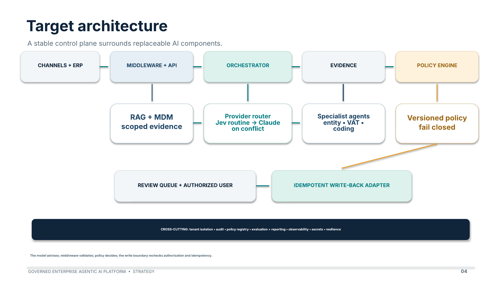

# AP Automation — self-learning non-PO invoice coding (POC)

[](https://github.com/WaiteM124/ap-automation-public/actions/workflows/ci.yml)

Predicts the GL code for non-PO invoice lines from the company's own coding history, auto-posts the ones it is sure about, sends the rest to a human, and **learns only from what humans confirm**.

This repository is a portfolio / showcase copy of a private proof of concept. It contains **synthetic** invoice data and public-data replay results only. It does not include live credentials, cloud account identifiers, or client ledgers.

Contributor and agent guide: [AGENTS.md](AGENTS.md) · [CONTRIBUTING.md](CONTRIBUTING.md) · [docs/decisions/](docs/decisions/).

**Platform architecture:** this POC is the first proving ground for a governed enterprise agentic AI platform, in which models provide evidence, policy owns decisions and humans keep authority over financial actions. See [ARCHITECTURE.md](ARCHITECTURE.md) and the [14-slide strategy deck](docs/architecture-strategy.pdf).



## How it decides

Every invoice line gets two decisions. Only the second can authorise a posting.

| Decision | Made by | Field |
|---|---|---|
| Rule gate | evidence + confidence | `routing_decision` |
| **Governed decision** | rule gate + specialist agents + (optional) LLM gate | **`final_routing`** |

An invoice is auto-posted only if **all** of these hold:

1. at least `MIN_EVIDENCE_LINES` (3) human-confirmed lines exist for the **resolved vendor** — there is no cross-vendor fallback, so a cold-start vendor goes to review rather than borrowing someone else's history
2. the vendor name resolves with confidence >= `MIN_MDM_CONFIDENCE` (0.85)
3. >= `MIN_AGREEMENT_RATIO` (80%) of the retrieved lines agree on the GL, and weighted confidence >= the threshold
4. no specialist agent raises a flag — entity, VAT (blocked / reverse-charge / not assessed / high-value review) and cost-centre validation, all driven by one chart of accounts (`core/chart_of_accounts.py`)

The optional LLM gate can only make the decision **stricter** (`governance.never_loosen`). The system **fails closed**: retrieval errors, agent errors and non-UK entities all route to review.

`pipeline.confirm()` enforces the rule itself: asking it to auto-post a prediction whose `final_routing` is not `auto_post` raises `AutoPostNotPermitted`, whatever the caller (API, batch, UI) does.

## How it learns

Only **human-confirmed or human-corrected** lines are written back to the vector corpus. Auto-posts are **never** learned from — otherwise the corpus would agree with itself and the automation rate would rise without any new information. Retrieval also ignores any point whose source is `auto_post`.

Every posting (auto or human) goes through one function, `core/posting.py::post_outcome`: confirm -> ERP ledger -> audit record -> write-back (humans only) -> optional Google Sheets mirror.

Optional SAP and Xero adapters can post a governed `auto_post` result to an ERP. Both are **off by default** and documented in [docs/SAP_POSTING.md](docs/SAP_POSTING.md) and [docs/XERO_POSTING.md](docs/XERO_POSTING.md).

## Architecture

```
invoice line
    -> vendor resolution (MDM, no cross-vendor fallback)
    -> hybrid retrieval (dense + BM25, vendor-only, RRF)
    -> rule / confidence gate          -> routing_decision
    -> specialist agents (entity, VAT, cost-centre)
    -> optional LLM gate (stricter only)
    -> final_routing  (auto_post | human_review)
         |                    |
         v                    v
     post_outcome        review queue
     (not learned)       human confirm / correct
                              |
                              v
                         corpus write-back
```

The same pipeline is available as a LangGraph graph (`ap_automation/graph`, `langgraph.json`), including a human-in-the-loop interrupt path for a review queue. Observability (Langfuse) and analytics (local SQLite, optional Supabase) are best-effort and never change the decision.

Diagrams: [docs/architecture](docs/architecture).

## Measured results (synthetic, offline)

`python scripts/evaluate_poc.py` runs 800 synthetic invoices (600 routine, 150 near-edge, 50 hard-edge, with labelled governance anomalies injected) against a fresh corpus **twice**: once with learning and once as a no-learning control, using a simulated reviewer that applies the ground-truth GL. Latest run (seed 42; fully reproducible, every run gives identical numbers; saved in [docs/evaluation.json](docs/evaluation.json)):

| Measure | Result |
|---|---|
| Automation rate | **73.6%** (control without learning: 64.4%) |
| Auto-post accuracy | **99.8%** (1 wrong of 589 auto-posts) |
| Vendors that began with no history | 0% auto without learning -> **79.7%** with it; first auto-post after 4 reviews |
| Hard-edge (unknown vendor) automation | 0% |
| Injected anomalies (wrong entity, cost centre, blocked VAT, reverse charge) caught | 21 / 21 |
| Forced auto-post of a rejected prediction | 211 / 211 refused |
| Auto-posted lines written back to the corpus | 0 |

The script prints the per-window automation curve and a breakdown of **why** invoices go to review. It exits non-zero if any claim fails, so it is usable as a regression gate.

### What these numbers do and do not show

- The data is **synthetic**, and its structure (vendor -> GL patterns, anomaly injection) was written for this POC. The numbers validate the *mechanics* of the loop, not performance on a real ledger. Run the same harness on exported history before quoting a rate externally.
- The offline run uses a lexical hashing embedder, not `text-embedding-3-small`. It proves the loop works; it says nothing about embedding quality. Use `python scripts/evaluate_poc.py --live-embeddings` (needs `OPENAI_API_KEY` and a few cents of usage) to measure with the real model.
- The simulated reviewer is always right. Real reviewers make mistakes, and a wrong confirmation is learned.
- A small residual auto-post error rate remains by design (1 in 589 here): the gate is tuned on evidence agreement, not tuned to zero out errors on the synthetic set.

A separate public-data replay (Los Angeles Checkbook) is described in [docs/case_study_la_checkbook.md](docs/case_study_la_checkbook.md).

## Run it

```bash
pip install -e ".[dev]"            # or: pip install -r requirements.txt
pytest                             # 348 tests collected; 347 passed, 1 skipped, fully offline
python scripts/evaluate_poc.py     # the measurements above, fully offline
python scripts/check_eval_gate.py  # same + compare to docs/evaluation.json (CI eval gate)
```

CI (GitHub Actions) runs pinned `ruff check`, `pytest`, and the offline **eval gate** (`scripts/check_eval_gate.py` vs `docs/evaluation.json`) on every push and pull request to `main`. No secrets are required. Eval numbers are **synthetic**.

### Recorded demo (deterministic)

```bash
python scripts/run_demo.py         # offline, LLM gate off, seeded corpus, API on :8000
# in the Next.js UI repo (separate):
AP_API_URL=http://localhost:8000 npm run build && npx next start -p 3100
```

The UI shows a scripted scenario strip: a routine auto-post, two safety cases (a blocked-VAT invoice and a wrong cost centre that the rule gate would have passed but governance stops), an unknown vendor, and a five-invoice learning arc for a new vendor (human confirms 1-3, auto-posts from 4). **Reset demo** restores the identical starting state between takes (`POST /demo/reset`, only available when `DEMO_MODE=true`). `tests/test_demo_story.py` replays the whole story, so the script cannot silently drift.

Flags: `--llm` enables the Claude escalation gate (non-deterministic, so off by default), `--live` uses real OpenAI embeddings and Qdrant instead of the offline lexical backend, `--port` changes the port.

Live stack (Qdrant + OpenAI embeddings):

```bash
docker run -p 6333:6333 qdrant/qdrant
cp .env.example .env               # set OPENAI_API_KEY etc. — never commit .env
python -m uvicorn main:app --reload --port 8000     # API
streamlit run ap_automation/ui/app.py               # UI
```

In the UI: **Setup** -> generate dataset -> seed corpus; **Batch Processing** -> upload `data/invoices.csv`. With *Simulate a reviewer* ticked, review-routed rows are resolved from the CSV's `ground_truth_gl` and learned from, which is what makes the corpus grow during a demo.

## API (`main.py`)

| Endpoint | Purpose |
|---|---|
| `GET /health` | liveness + corpus size |
| `POST /predict` | returns `routing_decision` (rule gate), **`final_routing`**, reasons, flags, evidence |
| `POST /confirm/{id}` | human confirmation / correction; idempotent (409 on repeat); GL validated against the chart |
| `POST /batch`, `GET /batch/{id}`, `DELETE /batch/{id}` | async CSV batch; `simulate_reviewer=true` optional |
| `POST /auto-post/{id}` | posts a prediction the governed gate approved; **403 otherwise**; never learned from |
| `GET /ledger`, `GET /audit` | ERP postings and the audit trail with the full decision record |
| `GET /sap/status`, `GET /sap/postings` | SAP posting state (host only, no secrets); SAP posting attempts incl. failed ones |
| `GET /xero/status`, `GET /xero/postings` | Xero posting state (no secrets) |
| `GET /post-ready` | ERP-neutral post-ready payload for a coded invoice |
| `POST /readiness` | data-readiness report on coded history |
| `GET /corpus/vendors`, `GET /corpus/vendors/{id}`, `DELETE /corpus/points/{id}` | corpus explorer; remove a bad evidence line |
| `GET /analytics`, `GET /performance` | measured from recorded predictions (local SQLite; Supabase too when configured) |
| `GET /evaluation` | latest offline evaluation (`docs/evaluation.json`) |
| `GET /demo/status`, `GET /demo/scenarios`, `POST /demo/reset` | demo pre-flight, scripted scenarios, reset (`DEMO_MODE=true` only) |

Set `API_KEY` to require an `X-API-Key` header on everything except `/health`, `/evaluation` and the demo read endpoints, and `CORS_ORIGINS` to restrict browsers. Predictions awaiting confirmation are stored in SQLite (`PREDICTIONS_DB_PATH`) so a restart does not break `/confirm`.

If `API_KEY` is unset, mutating routes are reachable by anyone who can reach the process — do not expose the service that way.

## Configuration

All settings come from the environment / `.env` (see `.env.example` and `ap_automation/core/config.py`). Names only — put real values in a local `.env` or your host's secret store, never in the repository.

**Core:** `OPENAI_API_KEY`, `QDRANT_HOST`, `QDRANT_PORT`, `QDRANT_API_KEY`, `QDRANT_COLLECTION`, `ANTHROPIC_API_KEY` (optional LLM gate), `API_KEY`, `CORS_ORIGINS`.

**Telemetry (optional):** `LANGFUSE_PUBLIC_KEY`, `LANGFUSE_SECRET_KEY`, `LANGFUSE_HOST`, `SUPABASE_URL`, `SUPABASE_SECRET_KEY`, `TELEMETRY_ENABLED` (set `false` to send nothing).

**Posting:** `ERP_BACKEND` (`simulated` / `sap` / `xero`), `ERP_URL`, `GOOGLE_SHEET_ID`, `GOOGLE_SHEETS_CREDENTIALS`, and the `SAP_*` / `XERO_*` variables documented in the posting guides. SAP and Xero writes stay off unless the backend *and* the corresponding `*_POSTING_ENABLED` flag are set.

**Gate thresholds:** `MIN_EVIDENCE_LINES`, `MIN_MDM_CONFIDENCE`, `MIN_AGREEMENT_RATIO`, `DEFAULT_CONFIDENCE_THRESHOLD`.

Unknown variables in `.env` are ignored.

A redacted ECS/Fargate task-definition template (placeholders only; secrets via Secrets Manager) is in [deploy/ecs-task-definition.example.json](deploy/ecs-task-definition.example.json).

## Layout

```
main.py                    FastAPI app (single entry point)
ap_automation/
  core/    pipeline, governance, posting, confidence gate, hybrid retrieval,
           chart of accounts, SAP / Xero adapters, readiness, synthetic dataset
  agents/  entity, VAT, cost-centre specialists + orchestrator
  graph/   LangGraph version of the same pipeline, including a cloud interrupt path
  ui/      Streamlit app
scripts/   evaluate_poc.py (start here), demos, public-data replay, Langfuse helpers
tests/     offline pytest suite (348 collected)
docs/      concise documentation set (see docs/README.md)
deploy/    redacted infrastructure templates
onboarding/ chart-of-accounts and invoice-history CSV templates
```

## Known limitations

- Vendor master data (MDM) is a CSV lookup with conservative fuzzy matching; real vendor resolution would sit in an MDM service.
- VAT handling is a rule-based screen, not a tax engine: it flags risk for review, it does not compute VAT.
- Only the UK VAT rules are modelled; other jurisdictions route to review.
- No per-user authentication or approval workflow; `API_KEY` is a single shared secret.
- Job state for batch runs is in-process memory (Supabase mirrors it when configured).

## Licence

MIT — see [LICENSE](LICENSE). Copyright (c) 2026 Miles Waite.
